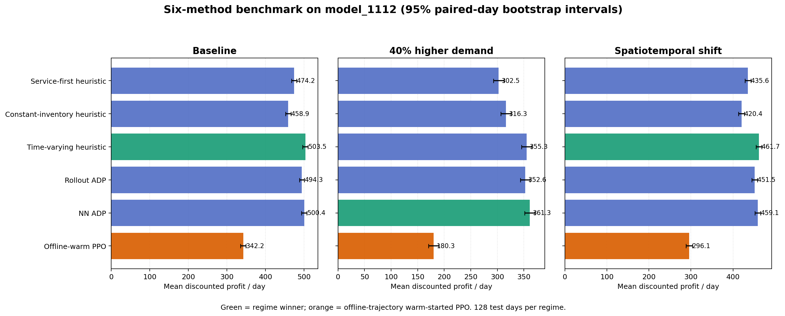

# Mobile charging: pricing and fleet dispatch

This branch studies how a mobile-charging operator should set prices and dispatch a fleet of mobile charging vehicles (MCVs). Each simulated hour follows the same sequence: post a price, observe customer choices, dispatch every MCV, and record operating profit. One episode is a 12-hour day; the reported score is total discounted daily profit in dollars.

`model_1112` now uses one six-method benchmark as its current scorecard. Older README tables described earlier scenarios and PPO variants and are not carried forward here.

## Current six-method benchmark

The benchmark is anchored to commit `574ef42b1c3d5a4ce1dc9998a5670e89eb5fc452`. Every method is evaluated on the same 128 test days in each demand regime. Learned methods average policy seeds 7, 19, and 37 before the paired-day bootstrap.

| Method | Baseline | 40% higher demand | Spatiotemporal shift |
|---|---:|---:|---:|
| Service-first heuristic | 474.21 [467.45, 480.79] | 302.55 [292.70, 312.49] | 435.62 [428.61, 442.72] |
| Constant-inventory heuristic | 458.88 [451.86, 465.83] | 316.29 [306.70, 325.83] | 420.36 [413.43, 427.44] |
| **Time-varying-inventory heuristic** | **503.48 [496.52, 510.34]** | 355.29 [345.86, 364.64] | **461.72 [455.02, 468.36]** |
| Rollout ADP | 494.35 [488.09, 500.74] | 352.62 [343.52, 361.75] | 451.54 [444.77, 458.16] |
| **NN ADP (offline trajectories)** | 500.44 [493.61, 507.21] | **361.30 [351.57, 370.72]** | 459.10 [452.03, 465.89] |
| Offline-warm PPO | 342.19 [335.36, 349.03] | 180.28 [170.67, 190.20] | 296.07 [288.55, 303.55] |

Values are mean discounted profit per test day with a 95% bootstrap interval. The interval measures variation across the fixed test-day bank; it does not include uncertainty from retraining on different random seeds.



### The six methods

1. **Service-first heuristic** greedily assigns vehicles to currently profitable requests and recharges only when energy is low.
2. **Constant-inventory heuristic** maximizes current profit plus one constant shadow value for stored battery energy.
3. **Time-varying-inventory heuristic** uses a larger battery shadow value early in the day and a smaller value later.
4. **Rollout ADP** scores feasible fleet plans by exact current profit plus Monte Carlo continuation value under the fitted historical market model.
5. **NN ADP** trains a neural continuation-value estimator on a sealed mixed bank of 768 offline trajectory days, then uses it to rank feasible fleet plans.
6. **Offline-warm PPO** uses the same sealed 768-day offline bank to initialize the pricing actor/critic and dispatch actor/critic. It then runs 512 fresh on-policy PPO training days. Realized final profit jointly updates pricing and dispatch through interleaved GAE with separate pre-choice and post-choice critics.

### Main findings

- Time-varying inventory has the highest mean profit in the baseline and spatiotemporal-shift regimes.
- NN ADP is highest under 40% higher demand and exceeds Rollout ADP in all three regimes on the paired test days.
- Offline-warm PPO remains below all five alternatives after the matched offline warm start and 512 joint on-policy days. The experiment therefore does not support claiming that warm-started PPO outperforms the ADP or heuristic baselines.

The full protocol, pairwise intervals, limitations, and artifact links are in [Study 13](docs/studies/13_offline_warm_ppo.md). The machine-readable scorecard is [offline_warm_ppo_benchmark_summary.json](docs/results/offline_warm_ppo_benchmark_summary.json).

## Quick start

Python 3.10 or later is required.

```bash
python3 -m venv .venv
source .venv/bin/activate
python -m pip install -e '.[train]'

python examples/manual_walkthrough.py
```

Run the tracked NN ADP studies with:

```bash
python experiments/run_logged_nn_adp_study.py --help
python experiments/run_candidate_adp_study.py --help
```

## Documentation

| Guide | Contents |
|---|---|
| [MODEL.md](docs/MODEL.md) | Customer choice, pricing, fleet state, batteries, and profit |
| [METHODS.md](docs/METHODS.md) | How the controllers decide and what information they use |
| [Study 13](docs/studies/13_offline_warm_ppo.md) | Current six-method protocol and results |
| [RESULTS.md](docs/RESULTS.md) | Current scorecard followed by clearly labeled historical studies |
| [RUNNING.md](docs/RUNNING.md) | Commands for the maintained experiment workflows |

## Code map

| Component | Main files |
|---|---|
| Heuristic policies | `src/charging_env/benchmarks/policies.py`, `src/charging_env/benchmarks/scalable.py` |
| Rollout ADP | `src/charging_env/rl/rollout_adp.py` |
| NN ADP | `src/charging_env/rl/candidate_value.py`, `src/charging_env/rl/candidate_training.py` |
| PPO actors, critics, and trainer | `src/charging_env/rl/paper_ppo.py`, `src/charging_env/rl/paper_train.py` |
| NN ADP experiment runners | `experiments/run_logged_nn_adp_study.py`, `experiments/run_candidate_adp_study.py` |

## Evidence boundaries

The histories and test days are synthetic. Controllers are frozen during testing, invalid actions are rejected, and learned controllers cannot query future private demand. Results compare the implemented controllers under this protocol; they are not evidence that one algorithm family dominates in every environment or at equal compute.
