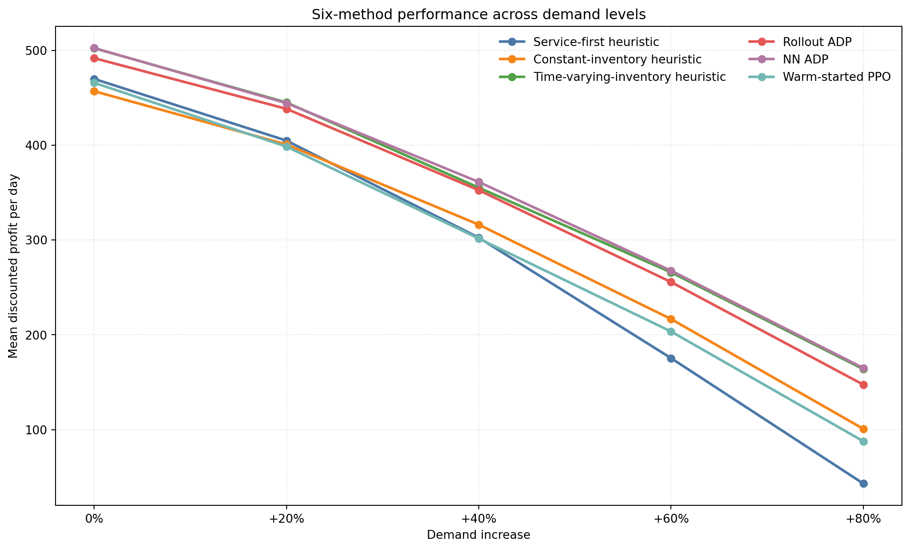

# Mobile charging: pricing and fleet dispatch

This branch studies how a mobile-charging operator should set prices and dispatch a fleet of mobile charging vehicles (MCVs). Each simulated hour follows the same sequence: post a price, observe customer choices, dispatch every MCV, and record operating profit. One episode is a 12-hour day; the reported score is total discounted daily profit in dollars.

`model_1112` now uses one six-method benchmark as its current scorecard. Older README tables described earlier scenarios and PPO variants and are not carried forward here.

## Current demand benchmark

Every demand level uses the same 128 frozen test days. Learned methods average policy seeds 7, 19, and 37.

| Method | Baseline | 20% higher demand | 40% higher demand | 60% higher demand | 80% higher demand |
|---|---:|---:|---:|---:|---:|
| Service-first heuristic | 470.02 | 404.90 | 302.55 | 175.42 | 43.10 |
| Constant-inventory heuristic | 457.04 | 400.83 | 316.29 | 216.69 | 100.82 |
| **Time-varying-inventory heuristic** | 502.34 | **445.16** | 355.29 | 265.91 | 163.81 |
| Rollout ADP | 491.88 | 438.43 | 352.62 | 255.71 | 147.44 |
| **NN ADP** | **502.62** | 444.44 | **361.30** | **267.74** | **164.99** |
| Warm-started PPO | 465.86 | 398.63 | 301.62 | 203.51 | 87.70 |

Values are mean discounted profit per test day. The line chart compares the six methods.



### The six methods

1. **Service-first heuristic** greedily assigns vehicles to currently profitable requests and recharges only when energy is low.
2. **Constant-inventory heuristic** maximizes current profit plus one constant shadow value for stored battery energy.
3. **Time-varying-inventory heuristic** uses a larger battery shadow value early in the day and a smaller value later.
4. **Rollout ADP** scores feasible fleet plans by exact current profit plus Monte Carlo continuation value under the fitted historical market model.
5. **NN ADP** trains a neural continuation-value estimator on a sealed mixed bank of 768 offline trajectory days, then uses it to rank feasible fleet plans.
6. **Warm-started PPO** uses the same sealed 768-day offline bank to initialize the pricing actor/critic and dispatch actor/critic. It then runs 2,048 PPO updates with 16 fresh on-policy days per update (32,768 days per seed). The online phase uses pure PPO with no pricing- or dispatch-behavior-cloning constraint. Realized final profit jointly updates pricing and dispatch through interleaved GAE with separate pre-choice and post-choice critics.

### Main findings

- NN ADP has the highest mean profit at baseline, +40%, +60%, and +80% demand.
- Time-varying inventory is highest at +20% demand and stays close to NN ADP across the sweep.
- Extending Warm-started PPO from 32 to 2,048 updates raises baseline profit from 345.64 to 465.86 and keeps profit positive through +80% demand. It remains below NN ADP and the strongest inventory/rollout baselines at every level.

The updated long-training protocol, learning-curve comparison, limitations, and artifact links are in [Study 16](docs/studies/16_long_horizon_offline_warm_ppo.md). The original 512-day benchmark remains documented in [Study 13](docs/studies/13_offline_warm_ppo.md). The machine-readable table is [demand_sweep_0_80_six_methods.csv](docs/results/demand_sweep_0_80_six_methods.csv).

### Fleet-size sensitivity

Study 14 evaluates all six methods under baseline demand on one shared 128-day test bank. NN ADP and Offline-warm PPO are retrained for fleet sizes 5 and 15 because their network dimensions depend on the number of vehicles. Every PPO seed receives the matched offline warm start followed by 512 on-policy training days.

| Method | Fleet size = 5 | Fleet size = 10 | Fleet size = 15 |
|---|---:|---:|---:|
| Service-first heuristic | 347.28 | 470.02 | 562.37 |
| Constant-inventory heuristic | 386.90 | 457.04 | 540.32 |
| Time-varying-inventory heuristic | 431.97 | 502.34 | 567.24 |
| Rollout ADP | 423.20 | 491.88 | **573.41** |
| NN ADP | **436.09** | **502.62** | 555.62 |
| Warm-started PPO | 341.91 | 465.86 | 369.42 |

The exact fleet layouts, training protocol, validation counts, and limitations are in [Study 14](docs/studies/14_fleet_size_sensitivity.md).

### Warm-started PPO ablation at fleet size 10

| Ablation | Offline days | On-policy PPO days | Mean discounted profit/day |
|---|---:|---:|---:|
| Warm-start only | 768 | 0 | 274.11 |
| PPO only | 0 | 512 | -201.42 |
| Warm-started PPO | 768 | 512 | **345.64** |

The matched ablation shows that the offline stage supplies a viable initial pricing and dispatch policy, while 512 on-policy PPO days add another 71.53 profit per day after warm initialization. PPO from random initialization remains negative at the same 512-day budget. Full protocol and limitations: [Study 15](docs/studies/15_offline_warm_ppo_ablation.md).

## Quick start

Python 3.10 or later is required.

```bash
python3 -m venv .venv
source .venv/bin/activate
python -m pip install -e '.[train]'

python examples/manual_walkthrough.py
```

Run the tracked NN ADP studies with:

```bash
python experiments/run_logged_nn_adp_study.py --help
python experiments/run_candidate_adp_study.py --help
```

## Documentation

| Guide | Contents |
|---|---|
| [MODEL.md](docs/MODEL.md) | Customer choice, pricing, fleet state, batteries, and profit |
| [METHODS.md](docs/METHODS.md) | How the controllers decide and what information they use |
| [Study 16](docs/studies/16_long_horizon_offline_warm_ppo.md) | Current six-method scorecard with 2,048-update Offline-warm PPO |
| [Study 13](docs/studies/13_offline_warm_ppo.md) | Original 512-day Offline-warm PPO benchmark |
| [RESULTS.md](docs/RESULTS.md) | Current scorecard followed by clearly labeled historical studies |
| [RUNNING.md](docs/RUNNING.md) | Commands for the maintained experiment workflows |

## Code map

| Component | Main files |
|---|---|
| Heuristic policies | `src/charging_env/benchmarks/policies.py`, `src/charging_env/benchmarks/scalable.py` |
| Rollout ADP | `src/charging_env/rl/rollout_adp.py` |
| NN ADP | `src/charging_env/rl/candidate_value.py`, `src/charging_env/rl/candidate_training.py` |
| PPO actors, critics, and trainer | `src/charging_env/rl/paper_ppo.py`, `src/charging_env/rl/paper_train.py` |
| NN ADP experiment runners | `experiments/run_logged_nn_adp_study.py`, `experiments/run_candidate_adp_study.py` |

## Evidence boundaries

The histories and test days are synthetic. Controllers are frozen during testing, invalid actions are rejected, and learned controllers cannot query future private demand. Results compare the implemented controllers under this protocol; they are not evidence that one algorithm family dominates in every environment or at equal compute.
