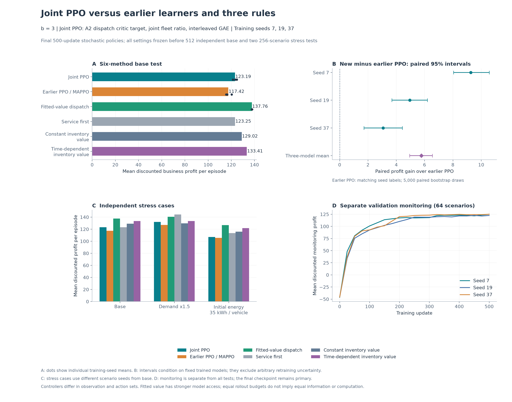

# Approximate dynamic programming, PPO, and the benchmark rules

The project currently has **three learned controllers**: fitted-value dispatch, earlier SA-PPO/MAPPO, and Joint PPO. Fitted-value dispatch is the approximate dynamic programming method. The two PPO controllers learn policies with neural networks. They learn different components of the controller and use the simulator differently.

On the latest shared independent tests, **fitted-value dispatch earns the most profit in the base and low-inventory cases**. **Joint PPO improves on earlier PPO**, but remains below fitted value and the time-dependent inventory rule. Service-first has the highest mean profit in the high-demand case. There is therefore no single winner across all three cases.

This page explains those results and their limits. For commands, start with [TRAINING.md](TRAINING.md). For the model being controlled, see [MODEL.md](MODEL.md). The full method guides are [FITTED_VALUE.md](methods/FITTED_VALUE.md), [JOINT_PPO.md](methods/JOINT_PPO.md), and [LEGACY_PPO.md](methods/LEGACY_PPO.md).

For a quick answer, go to the [results table](#results-on-the-same-independent-scenarios). To understand the ranking, read [how the methods choose actions](#how-approximate-dp-and-ppo-make-decisions), then [the operating behavior behind the gap](#operating-behavior-behind-the-profit-gap).

## What every controller is trying to achieve

Each physical period has two decisions. The operator first quotes mobile charging prices. Customers then choose mobile charging, a fixed station, or the outside option. After seeing those choices, the operator dispatches the mobile charging vehicles (MCVs).

All reported scores use the same original business profit: mobile and fixed-station revenue, plus electricity export revenue, minus procurement, travel, operating, and unmet-demand costs. The primary score is **discounted profit per episode**, in dollars. Period 1 has weight 1, period 2 has weight 0.99, and so on over the 12-period horizon. The recorded scenario gives no terminal payment for leftover battery energy. A higher score means a larger expected discounted operating profit under this accounting; it does not necessarily mean more customers served.

The main scenario is `configs/utility_b3.json`: two MCVs, four locations, and `b=3`. Here `b` is the charging-utility intercept: it makes charging options more attractive relative to leaving. All methods in the comparison use the same `b=3` customer-choice model and physical constraints.

## How approximate DP and PPO make decisions

A **policy** is a rule for choosing an action from the information currently available. A **value** estimates the profit that can still be earned from a state. The controllers differ in how they use these two ideas.

### Approximate DP: learn future value, then compare current actions

Fitted-value dispatch fixes the mobile price at **\$0.60/kWh** and learns how valuable each combination of time, vehicle locations, and battery levels is. It builds a value table backward from the end of the episode. Battery levels lie on a grid during training; interpolation supplies values between grid points.

When a dispatch decision arrives, the controller evaluates feasible joint actions for both vehicles using the known one-period model. It selects the action with the largest sum of:

1. the business profit earned in the current period; and
2. the discounted learned value of the resulting fleet state.

This is **approximate dynamic programming (ADP)** because the future value is estimated from sampled demand and a battery grid. Current action search is exact over its finite candidate grid, but that does not make the full-horizon controller globally optimal. The implementation supports exactly two MCVs. It learns dispatch continuation value; it does not learn prices or a neural-network actor.

### PPO: learn which actions to choose from experience

PPO runs complete episodes, samples actions from its current policy, and learns from the resulting rewards. Its actors produce action probabilities; its critics estimate future return and help determine whether a sampled action did better or worse than expected. Its clipped learning objective reduces the incentive for large changes in sampled-action probabilities; it does not impose a hard bound on those changes.

Both PPO variants learn **mobile pricing and dispatch**. At execution time, their actors choose actions directly from observations. They use feasibility masks and the simulator's physical limits, but they do not enumerate all alternative joint actions and calculate each one's current profit before choosing.

For example, consider a vehicle with a low battery early in the day. Serving now can earn immediate revenue; recharging costs money but may enable more service later. ADP explicitly compares the modeled current profit plus learned future value for these options. An inventory rule makes a similar calculation using a simple assigned value per remaining kWh. PPO must learn a probability of recharging from experiences in which this immediate cost eventually paid off. This example explains the approaches; it is not a claim that any particular saved policy makes the right choice in every low-battery state.

| Question | Fitted-value dispatch / approximate DP | Joint PPO | Earlier SA-PPO/MAPPO |
|---|---|---|---|
| What is learned? | A continuation-value table | Pricing actor, dispatch actor, and two critics | Pricing actor, shared vehicle dispatch actor, and two critics |
| How is pricing chosen? | Fixed at \$0.60/kWh where mobile service is available | Learned categorical price at each available location | Learned categorical price at each available location |
| How is dispatch chosen? | Search joint fleet actions using modeled current profit and learned continuation value | Sample vehicle action factors from a global post-choice observation | Sample a shared actor for each vehicle from its local observation, which also includes peer and demand information |
| What can training query? | Synthetic demand at arbitrary feasible fleet-grid states, plus every candidate's one-period outcome | Outcomes of actions sampled during episode rollouts | Outcomes of actions sampled during episode rollouts |
| How much recharge/export can an action request? | Half or all of its individually feasible amount | All of its individually feasible amount | A learned continuous fraction of a fixed nominal energy scale; physical limits then reduce the request |
| What happens at a busy station? | The environment applies shared station capacity | The environment applies shared station capacity | The environment applies shared station capacity |

The table describes the actual implementations and recorded settings. “All of its individually feasible amount” is a request before shared capacity allocation; it does not guarantee that the vehicle receives that amount. Earlier PPO instead multiplies its sampled fraction by `max(mobile_charge_kw, mobile_discharge_kw) * period_hours`, which is 30 kWh here, before the simulator applies travel, battery, power, and station limits. None of the controllers receives future realized demand or future random price shocks.

## Differences between the two PPO versions

Both retain the pricing-then-dispatch structure, separate stage critics, and a shared business objective. Joint PPO changes more than one detail:

| Aspect | Earlier PPO used in this comparison | Joint PPO used in this comparison |
|---|---|---|
| Dispatch update | Clip each vehicle's likelihood ratio separately, then average the losses | Multiply the vehicle likelihood ratios and clip the resulting fleet ratio once |
| Information before pricing | Encodes realized current requests before their choices are resolved | Uses fleet state, arrival rates, time, and current prices; hides realized requests from both pricing actor and critic |
| Dispatch observation | Shared actor receives each vehicle's local observation with included peer information | Actor receives the complete current post-choice state and outputs a factor for each vehicle |
| Dispatch actions | Five simulator modes, a target, and a continuous recharge/export fraction | Four operation labels and a target; idle means waiting or repositioning, and recharge/export requests use the full feasible amount |
| Advantage trace | Trace factor 1 within a period; configured inter-period lambda is 1.0 | Lambda 0.95 applies at both decision stages |
| Training signals | Normalized advantages, period-weighted actor losses, and inventory-potential reward shaping | Raw advantages, uniform period weighting in the surrogate loss, and original rewards |
| Exploration bonus | Pricing bonus plus a dispatch bonus that decreases during training | Dispatch bonus only, summed over vehicles |

An **advantage** estimates how much better a sampled action performed than its critic expected. The trace parameter, lambda, controls how advantage estimates combine successive prediction errors. Both implementations discount future business rewards once per physical period. The extra lambda between stages in Joint PPO is not an extra business-profit discount.

Joint PPO also uses its own SiLU networks and four independent optimizers. Its dispatch critic uses dispatch advantage plus the old dispatch value, as specified in Equation (11) of the [algorithm specification](MDP_RL_2.pdf). The optional `pricing_advantage` target is an experimental alternative and was not used in the reported full runs.

These simultaneous changes mean the measured improvement belongs to **Joint PPO and its recorded settings**. The experiment does not isolate joint clipping, SiLU, lambda, or any other single change as the cause. A controlled ablation would change one factor while holding the others fixed.

## The six methods in the main comparison

The three learned controllers are compared with three useful rules. The rules were tuned on **128 separate validation scenarios**, with 82 candidate settings in total. One setting per family was frozen before testing.

| Benchmark | Decision principle | Setting selected on validation |
|---|---|---|
| Service-first | Serve current requests; replenish when usable inventory is low | Price \$0.80/kWh; recharge threshold 20% of usable battery above reserve |
| Constant inventory value | Search joint actions using current profit plus a fixed value for stored energy | Price \$0.60/kWh; inventory coefficient \$0.25 per stored kWh |
| Time-dependent inventory value | Use a higher inventory coefficient early and a lower one late | Price \$0.60/kWh; coefficient \$0.30 early, \$0.15 late; switch halfway through the horizon |

The artificial inventory coefficient is zero in the final period, when no future service remains. The two inventory rules use the same joint action grid and one-period model as fitted-value dispatch. They are strong planning baselines, rather than arbitrary or random behavior. Validation selected the **time-dependent inventory rule** as the primary heuristic baseline; the high-demand result did not change that selection afterward.

## Results on the same independent scenarios

Use the **2026-10-21 joint study** as the main scorecard. It reevaluates all methods on the same fresh scenarios. Earlier reports used different test seeds and remain historical records; their numbers should not be inserted into this table.

Each learned-method row averages three separately executed models, trained with seeds **7, 19, and 37**. It is not an ensemble that chooses or combines their actions. Both PPO rows use the final **500-update** checkpoints and stochastic execution, fixed before testing. Earlier PPO and fitted-value checkpoints were reused as frozen controls; the Joint PPO models were newly trained.

| Method | Base: 512 scenarios | High demand: 256 scenarios | Low inventory: 256 scenarios |
|---|---:|---:|---:|
| Approximate DP / fitted-value dispatch | **137.76** | 140.56 | **126.67** |
| Joint PPO | 123.19 | 131.93 | 106.90 |
| Earlier SA-PPO/MAPPO | 117.42 | 127.09 | 105.70 |
| Service-first | 123.25 | **144.48** | 113.56 |
| Constant inventory value | 129.02 | 129.77 | 115.90 |
| Time-dependent inventory value | 133.41 | 133.63 | 121.75 |

Entries are mean discounted business profit per episode, in dollars. High demand increases arrival means by 50%. Low inventory starts each vehicle with 35 kWh instead of 55 kWh. The learned parameters and rule settings remain frozen in both stress cases. Each column uses its own scenario bank, so compare methods within a column.

The paired base-test comparisons show:

- **Joint PPO improves on earlier PPO.** Its mean gain is **\$5.77 per episode, or 4.91%**, with a paired 95% interval of **[\$4.95, \$6.55]**. All three matched training seeds improve.
- **Approximate DP outperforms both PPO variants.** It earns **\$14.57 more than Joint PPO**, with a paired 95% interval of **[\$13.54, \$15.64]** for that advantage. Every fitted-value seed exceeds its matched Joint PPO seed.
- **The time-dependent inventory rule outperforms Joint PPO.** Joint PPO earns **\$10.22 less** than the time-dependent inventory rule, with a paired interval of **[-\$11.35, -\$9.12]** for PPO minus the rule. Its base mean is approximately tied with service-first.

### Variation across training runs

| Training seed | Earlier PPO | Joint PPO | Approximate DP | Joint PPO minus earlier PPO, with paired 95% interval |
|---|---:|---:|---:|---|
| 7 | 115.55 | 124.82 | 137.95 | +9.27 [8.05, 10.56] |
| 19 | 116.44 | 121.40 | 137.57 | +4.96 [3.69, 6.19] |
| 37 | 120.28 | 123.36 | 137.76 | +3.07 [1.71, 4.43] |

Joint PPO improves on earlier PPO in all three base runs. Under high demand, Joint PPO also improves on earlier PPO for all three seeds. Under low inventory, however, seed 19 declines by **\$0.86**, and its difference interval includes zero. The positive average low-inventory gain of \$1.20 is therefore not evidence of improvement for every training seed. Fitted-value dispatch leads the base and low-inventory tables, but service-first leads the high-demand table.

A **paired interval** is calculated by subtracting two methods' profits on each shared test scenario, then resampling those scenario differences. The reported intervals use 5,000 bootstrap resamples. They describe scenario/action sampling uncertainty for these fixed trained models. They do not include arbitrary retraining uncertainty, guarantee a win on every episode, or establish performance in a different city or fleet size. Three training seeds provide useful but limited evidence about training variability.

## Operating behavior behind the profit gap

The operating records show a substantial difference in battery replenishment. The following are fleet totals per base episode, averaged over the actual runs:

| Method | Mobile energy delivered (kWh) | Grid energy bought for MCV recharge (kWh) | Battery energy left at the end (kWh) |
|---|---:|---:|---:|
| Earlier PPO | 63.27 | 0.21 | 31.07 |
| Joint PPO | 69.57 | 0.17 | 28.67 |
| Time-dependent inventory rule | 140.34 | 81.17 | 16.89 |
| Approximate DP | 159.06 | 108.78 | 17.58 |

Both PPO variants recharge very little. Joint PPO uses the initial battery stock more productively and travels less: travel energy falls from 11.63 to 7.76 kWh. Its accounting gain over earlier PPO includes \$2.60 in lower discounted travel cost, \$2.42 in additional mobile revenue, and \$1.14 in lower unmet-demand cost, partly offset by other revenue and cost changes. It improves current operation while leaving the replenishment problem largely unresolved.

Approximate DP and the inventory rule repeatedly buy energy and use it for later service. Their higher mobile delivery is not explained by simply ending with larger batteries. ADP's learned continuation value explicitly considers how useful a recharged fleet state could be later; the current PPO runs have not learned comparable replenishment behavior.

This is an explanation supported by observed operating records, not a causal proof that any additional recharge would improve PPO. Prices, action sets, information, and planning capabilities also differ. The most direct next investigation would measure the value and learned probability of feasible recharge actions in the states where PPO waits, then test one targeted change on new test scenarios. The existing tests should remain fixed evidence, rather than become a tuning set.

## Scope and limitations of the comparison

The comparison is fair for the practical question, **“Which of these implemented controllers earns more under this simulator and test protocol?”** All controllers face common scenario seeds, identical physical and customer-choice rules, and the same profit accounting. The main test executes **12,288 policy episodes** over 1,024 distinct scenarios, with **zero invalid actions**. Training, monitoring, rule selection, and final testing use separate scenario banks.

It is not a comparison with equal information or equal computation:

| Per trained model | Approximate DP | Earlier PPO | Joint PPO |
|---|---|---|---|
| Main learning budget | 124,416 fleet-state/draw queries | 8,000 episodes; 96,000 physical periods | 8,000 episodes; 96,000 physical periods |
| Additional computation | Evaluate many candidate joint actions for every queried state | Reuse rollout batches in PPO updates | Reuse rollout batches for six epochs per update |
| Saved learned representation | 16,848 table values, including the terminal layer | Four neural networks | Four neural networks |
| Execution work | Model-based joint action search plus value interpolation | Actor forward passes and sampling | Actor forward passes and sampling |

ADP reuses 96 distinct period/draw seeds across the fleet grid in each training run; its 124,416 queries are not that many independent demand realizations or episodes. Across its three previously trained models, it evaluated about **53.7 million candidate outcomes**. PPO receives rewards for the actions it actually samples, while ADP and the coordinated rules can evaluate alternative current actions with the known model. No matched deployment-latency experiment was performed.

ADP also solves a narrower pricing problem by fixing the price. Joint PPO follows a more restrictive information convention before pricing than earlier PPO, and their energy action spaces differ. Consequently, the results establish a ranking of these implementations under the recorded conditions, not a universal ranking of approximate DP against PPO.

For the current two-vehicle base scenario, fitted-value dispatch is the strongest learned reference. For research on joint learned pricing and dispatch, Joint PPO is the stronger of the two tested PPO implementations, with the remaining inventory gap made explicit. Keep the earlier PPO as a reproducible control and the three rules as interpretable benchmarks. Scaling ADP to more vehicles or claiming a general PPO advantage requires a separate implementation and experiment.

## View the evidence without training again

The tables and figure on this page are included in the repository. If you also have the saved study in `outputs/paper_ppo_study/`, run these commands from the project root to display its scorecard and figure:

```bash
python3 experiments/summarize_paper_ppo_study.py --show
open docs/assets/algorithm_comparison.png
```

The `--show` command reads the saved analysis. It does not train, rerun evaluation, or modify results. The `open` command opens the existing image on macOS.



The monitoring curves use separate, repeatedly observed scenarios. A late plateau indicates that measured learning has stabilized over that range; it does not prove global convergence or replace the independent tests above.

The files below are local records under `outputs/`, which is not included in Git. Use the saved study files or [reproduce the experiment](TRAINING.md#reproduce-the-six-method-study) to inspect them.

For exact numbers and reproducibility, use the saved analysis (`outputs/paper_ppo_study/analysis.json`), frozen study protocol (`outputs/paper_ppo_study/protocol.json`), validation-selected rule settings (`outputs/paper_ppo_study/rule_selection/selection.json`), and test results (`outputs/paper_ppo_study/benchmarks/`). [TRAINING.md](TRAINING.md) explains how to run each controller, evaluate a checkpoint, and reproduce a fresh comparison.
