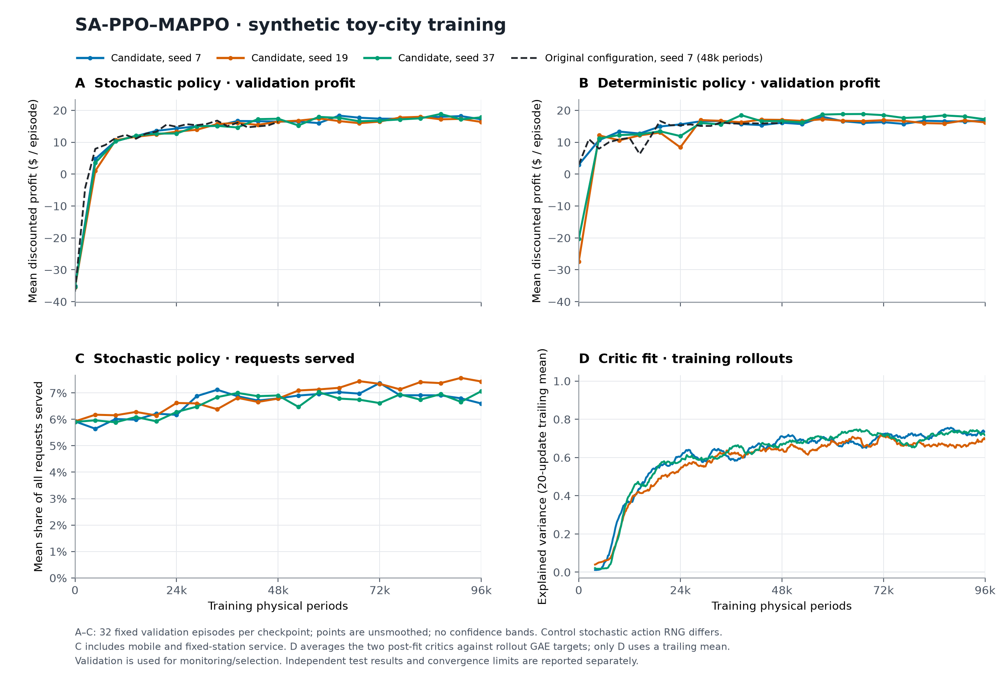

# Why the first training curve fell, and what longer training changed

This report answers an early debugging question: **why did the policy appear worse after ten training updates?** A policy is the learned rule for choosing prices and dispatch actions. The original check used too little training. It also evaluated actions chosen in a different way from the sampled actions used during PPO learning. Longer training produced profitable policies whose measured returns settled down. That stability did not establish that the policy earned as much as a strong dispatch rule.

This is a **historical experiment from 2026-10-17**, using the original customer model with charging-utility intercept **b=0**. This intercept is the common benefit customers assign to charging before costs are considered. A later independent [benchmark study](POLICY_BENCHMARKS.md) compared RL with other decision rules and measured mean stochastic RL profit of 16.49 against 22.75 for the inventory rule. For the later b=3 experiments, read [the SiLU study](SILU_B3_STUDY.md) and [the targeted training study](B3_TRAINING_IMPROVEMENTS.md). Their larger profit values come from a different customer model and do not by themselves show that the controller improved over this experiment.

## What is being measured?

An episode represents one 12-period operating horizon. In each period, the operator posts mobile prices, customers choose, and vehicles then dispatch. The period reward is the operator's business profit, including fixed charging station (FCS) operations as well as mobile charging vehicle (MCV) operations.

The reported return discounts later profit:

$$
G=\sum_{t=1}^{T}\gamma^{t-1}r_t,\qquad T=12,\quad\gamma=0.99.
$$

Here, $r_t$ is profit in period $t$. Code stores the first period as index 0: `period = t - 1`. With `profit[period]` storing that period's profit, the equivalent calculation is `sum(gamma**period * profit[period] for period in range(T))`. Units are model dollars per episode, rather than annual returns or forecasts of real operating profit. The [notation guide](NOTATION.md) explains the manuscript-to-code indexing and stage conventions.

Two evaluation modes matter throughout this report:

| Execution mode | How it chooses an action | What its result tells us |
|---|---|---|
| Stochastic | Randomly chooses actions using the learned price and dispatch probabilities | Estimates the sampled policy's average performance, which is what Proximal Policy Optimization (PPO) trains |
| Deterministic | Takes the most likely discrete action and the mean of the Beta distribution, which describes the exchange-energy fraction | Measures the rule obtained by turning the learned probabilities into fixed choices |

These modes can behave very differently while a policy is nearly **uniform**, meaning it gives almost equal probability to each allowed action. A small probability change can make a different action the most likely one, even when the full set of probabilities barely changes. A fall in deterministic profit therefore does not by itself show that PPO's sampled policy has become worse.

A training *update* first collects a batch of complete episodes, then uses that recorded experience several times to adjust the networks. Each full pass through the batch is an **epoch**; each smaller adjustment is an **optimizer step**. Runs with the same number of updates can therefore use different amounts of simulated experience and calculation. We report episodes and physical periods as well.

## What happened in the ten-update run?

The original execution check used **10 updates, 40 episodes, 480 physical periods, and 40 optimizer steps**. It measured only deterministic execution on four scenarios. That checked whether the program ran, but was too small to judge whether the policy was good.

We reevaluated the policy before learning and after update 10 on a separate shared set of **256 independent scenarios**. Matching environment and action random seeds made the comparison reproducible and reduced differences caused only by random draws. The two execution modes told different stories. In the table, **argmax** means taking the action with the highest probability, and **Beta mean** means taking the average of the learned exchange-energy fraction distribution:

| Original version, seed 7 | Initialization | Update 10 | Paired return change and 95% bootstrap interval |
|---|---:|---:|---|
| Deterministic: argmax + Beta mean | 0.773 | −3.000 | −3.773 [−5.285, −2.322] |
| Stochastic: sample from the policy | −37.009 | −30.589 | +6.420 [+5.425, +7.418] |

The sampled policy improved, while its deterministic counterpart worsened. Under deterministic execution, the discounted unmet-demand penalty rose from **4.530 to 13.299** even though travel cost fell from **7.887 to 1.348**. Saving travel cost did not help when pricing attracted requests that dispatch failed to serve. The [full accounting breakdown](../outputs/convergence_study/control_test_analysis.json) records these components.

Another check gave the old and updated policies the same states from another 128 scenarios, then compared their action probabilities. The **total variation distance** measures how much probability shifted between actions. Its mean was only about **0.060 for pricing and 0.084 for dispatch**. Nevertheless, the most likely actions changed about **84.1% and 63.7%** of the time. **Entropy** measures how spread out the action probabilities are: high entropy means many actions remain plausible, while low entropy means choices are concentrated on a few actions. Policy entropy was still about **99.5% and 99.0%** of the corresponding uniform distribution's entropy. The initial deterministic policy's apparent advantage was therefore sensitive to small probability differences.

The critics also predicted returns poorly. A **critic** predicts future return and gives the actor, the action-choosing network, a reference for deciding whether an action worked out better or worse than expected. We checked those predictions on another 128 stochastic episodes. The comparison target was the complete remaining discounted profit actually observed in each episode, called a **Monte Carlo target**. The old checkpoint's mean target was about **−16.38**, while both critics predicted means near **−4.1**. Their explained variances were about **0.006/0.010**, and RMSE was about **17.7**. **Explained variance** near zero means the predictions explain little of the variation in the targets. **RMSE**, or root mean squared error, measures prediction error in the same units as return and gives larger errors more weight.

The very short run and value clipping of 0.2 model dollars may have limited how well the critics could learn. **Value clipping** limits changes in the value estimate used by the learning loss. We did not change each setting separately and repeat training, so the study does not establish which one caused the poor fit. See [the old-policy diagnostics](../outputs/diagnostics_old/summary.json) and [critic-fit records](../outputs/diagnostics_old/critic_fit.json).

## What was checked and changed?

We first checked whether the code was learning from the intended two-stage return. Moving from pricing to dispatch stays within the same physical period, so that transition has discount 1. Moving to the next physical period has discount gamma. At the episode's end, the target uses no predicted value for a later state; this is what **no terminal bootstrapping** means. **Generalized advantage estimation (GAE)** combines rewards and critic predictions to estimate whether actions were better or worse than expected. It stops at episode boundaries. Pricing uses the probability of its whole price vector. Each vehicle uses the probability of its own dispatch action, with the same team advantage. The continuous energy fraction is scored using its Beta distribution before the simulator applies physical limits to the energy amount.

This review found no basic error in reward signs, repeated inter-period discounting, or action masks. The changes instead addressed evaluation reliability and training diagnostics:

| Change | Why it matters |
|---|---|
| Give stochastic evaluation its own per-episode action seeds and save/restore the Torch random number generator (RNG) state | Measuring validation performance should not change the random draws used by later training |
| Record both execution modes, standard errors, service outcomes, action counts, profit components, and critic prediction errors | Profit alone does not explain behavior; a standard error describes uncertainty in an estimated mean |
| Configure actor and critic learning rates independently, including when continuing a saved run | Action probabilities and return predictions can need different adjustment sizes |
| Weight both stages' action-learning score and exploration term by the same outer `gamma**period` factor | The score, called the policy surrogate, then gives earlier periods more weight, matching the discounted episode objective |
| Save both the final checkpoint and the checkpoint with highest stochastic validation profit; allow the initial policy to win | A checkpoint is a saved training state; validation chooses among states without using the test results |

The outer discount weight tells the actor how much each period should contribute to its learning score. GAE separately discounts future rewards when estimating return from a state. The old checkpoint default keeps the earlier approximation that gave each period equal weight in the actor score. Over 12 periods, the new outer weights range from 1 to about 0.895, so this change alone is too small to explain the large original decline.

This experiment kept the environment, business-profit formula, network architecture, and demand distribution fixed. At the time of this experiment, **64 tests passed**, including ten new checks for stochastic-evaluation isolation, old checkpoint loading, separate learning rates, discount weights, evaluation statistics, initial-policy selection, and zero target variance. CPU execution was verified; CUDA was not run. The current project's later test count is reported in [VALIDATION.md](VALIDATION.md).

## How was the longer-training comparison designed?

The comparison used one long run with the original settings and three runs with several adjusted settings. The original-settings run was the **control**: the reference used to judge the changes. The main questions were whether enough training produced a stable profitable policy, and whether tuning helped at the **same data budget**, meaning the same number of simulated training periods.

| Parameter or budget | Original-settings control | Adjusted configuration |
|---|---:|---:|
| Training seeds | 7 | 7, 19, 37 |
| Complete episodes per update | 4 | 16 |
| PPO epochs | 4 | 6 |
| Physical periods per minibatch | 48 | 192 |
| Actor learning rate | 3e-4 | 3e-4 |
| Critic learning rate | 3e-4 | 1e-3 |
| Value clip | 0.2 | 0, disabled |
| Entropy coefficient | 0.01 | 0.005 |
| Outer policy discount | Earlier equal-period approximation | `gamma**period` |
| Maximum updates | 1,000 | 500 per seed |
| Matched training-data budget | 48,000 periods | Update 250: 48,000 periods |
| Final training-data budget | 48,000 periods | 96,000 periods per seed |

Both groups kept hidden width 64, gamma 0.99, **GAE trace parameter $\lambda_{\mathrm{GAE}}$=0.95**, PPO probability-ratio clip 0.2, maximum gradient norm 0.5, and target Kullback–Leibler (KL) divergence 0.03. Hidden width is the number of features in each hidden network layer. The probability-ratio clip limits the actor's incentive to change action probabilities too much in one update; the gradient-norm limit bounds the size of the parameter-adjustment signal. **KL divergence** measures how much the action probabilities changed; the target is an early-stop threshold for PPO passes. The GAE parameter controls how return estimates combine observed rewards with critic predictions; it is distinct from the manuscript's arrival intensity $\lambda_{i,t}$. Larger batches were intended to make estimates less noisy. The higher critic learning rate and disabled value clip were intended to improve predictions. Because these settings changed together, the experiment cannot establish the effect of any single change. Equal training-data budgets also do not mean equal amounts of network-update calculation.

Training uses even environment seeds. A seed is the number used to reproduce a sequence of random draws. Validation uses 32 fixed scenarios, `100001 + 2*i` for `i=0..31`. Adjusted runs are evaluated in both modes every 25 updates and choose checkpoints by stochastic validation return. The original control is evaluated every 50 updates and chooses by deterministic validation return; its **final** model was specified in advance as the main control. Its stochastic curve uses a different sequence of sampled actions, so control and candidate curve points are not matched episode by episode.

The adjusted policies were tested after all three runs finished. The original control was already **frozen**: its saved network weights and settings remained fixed. It had been evaluated on the same test scenarios, with no further tuning based on those results. The test split is **256 scenarios**, `500001 + 2*i` for `i=0..255`, with action seed `70321`. We report the initial models, models with matching training-data budgets, final update-500 models, and validation-selected models for all three seeds. We do not use test profit to select a favorite seed or checkpoint.

A **paired comparison** runs both policies on the same environment scenarios, then subtracts their returns within each scenario. We form the confidence interval by **bootstrapping**: repeatedly resampling these scenario differences, with replacement, 5,000 times. The interval describes uncertainty from the choice of test scenarios for these already-trained models. It does not describe all the outcomes we might get by training again. Variation across the three training seeds is therefore reported separately. Original code, controls, configurations, and hashes are saved in [baseline_experiment](../outputs/baseline_experiment/) and [convergence_study](../outputs/convergence_study/). A hash is a file fingerprint used to detect changes. Training-period counts exclude validation and testing.

## Did longer training help?

Yes: both configurations moved from losses to profits. **Most of the evidence supports more training; it does not establish a clear advantage from the adjusted hyperparameters**, meaning the settings chosen before a run. The table uses the same 256 test scenarios. Original-version rows use training seed 7; adjusted rows average three separately executed policies.

| Model | Training periods per seed | Deterministic discounted return | Stochastic discounted return |
|---|---:|---:|---:|
| Original ten-update run | 480 | −3.000 | −30.589 |
| Original settings, final update 1,000 | 48,000 | 15.855 | 15.445 |
| Adjusted settings, update 250 | 48,000 | 16.052 | 15.483 |
| Adjusted settings, final update 500 | 96,000 | 16.414 | 16.309 |
| Adjusted settings, validation-selected models | 62,400 / 81,600 / 86,400 | 16.795 | 16.376 |

At the matched 48,000-period budget, the adjusted configuration gained only **+0.038 [−0.652, +0.694]** in mean stochastic return over the original control. For the same training seed 7, its stochastic change was **−0.483 [−1.188, +0.217]** and deterministic change **−0.931 [−1.588, −0.255]**. These results do not justify describing the bundle as better hyperparameters.

Extending the adjusted runs from 48,000 to 96,000 periods added **+0.826 [+0.493, +1.161]** in mean stochastic return. The adjusted final policies exceeded the original final control by **+0.864 [+0.121, +1.599]**, but used twice its data and had three training seeds rather than one. This is not a matched-budget, multiple-seed algorithm comparison.

Across the adjusted runs, mean stochastic return rose from **−37.060 at initialization to 16.309 at the final checkpoint**, a paired gain of **+53.369 [+51.618, +55.120]**. The sample standard deviation across training seeds was **0.306 for final stochastic return and 0.747 for deterministic return**.

| Training seed | Validation-selected update | Final deterministic return | Final stochastic return | Stochastic test return of validation-selected model |
|---|---:|---:|---:|---:|
| 7 | 325 | 15.598 | 16.008 | 15.187 |
| 19 | 425 | 16.577 | 16.298 | 16.803 |
| 37 | 450 | 17.067 | 16.621 | 17.137 |

A validation-selected checkpoint is the winner on validation, not necessarily on unseen data. Seed 7 illustrates this: its update-325 model scored below its final model on the independent stochastic test. Selection with 32 validation scenarios is noisy, so both checkpoint types are retained.

## Was training stable, and what did the policy actually do?



The six scheduled validation points at updates 375, 400, 425, 450, 475, and 500 remained within the following ranges:

| Seed | Deterministic min–max | Stochastic min–max | Sample SD of stochastic return across the six points |
|---|---:|---:|---:|
| 7 | 15.74–16.79 | 17.18–18.18 | 0.39 |
| 19 | 15.85–16.91 | 16.36–17.97 | 0.66 |
| 37 | 17.19–18.48 | 16.75–18.85 | 0.74 |

The later validation measurements stayed within a relatively narrow range and did not collapse. This is a **plateau**. **Convergence** usually means learning has settled toward a limiting solution; a flat curve on a fixed validation set alone does not prove that, or prove that the solution is best. It also does not establish performance in other scenarios. The original long-training control reached a profitable plateau too. The three adjusted runs used **24,000 episodes and 288,000 physical periods**; including the original control gives **336,000 periods**. Training metrics were finite, meaning no undefined or infinite values appeared. Training collection and independent testing had no invalid actions, and all three final checkpoints reproduced their evaluation results exactly after loading them again.

Over the final 50 updates, pricing-critic explained variance was about **0.65–0.71**, dispatch-critic explained variance **0.70–0.76**, and RMSE **3.47–4.34**. These compare predictions with GAE targets calculated from the batch currently being learned from. The earlier check used complete observed returns from independent episodes. Because the targets and evaluation data differ, these figures do not provide a controlled before/after comparison of prediction quality on unseen data.

Profit includes several businesses. The following **undiscounted** episode means add profit components without reducing the weight of later periods. They show where the money came from; costs are positive expenditures, and both columns use final stochastic policies.

| Revenue or cost | Original settings, seed 7 | Adjusted settings, three-model mean |
|---|---:|---:|
| Mobile charging revenue | 10.651 | 10.737 |
| FCS charging revenue | 29.049 | 28.651 |
| Discharge revenue | 8.144 | 8.370 |
| Electricity procurement cost | 13.598 | 13.403 |
| Travel cost | 4.906 | 4.008 |
| Operating cost | 12.000 | 12.000 |
| Unmet-demand penalty | 1.056 | 1.200 |
| Terminal inventory value | 0.000 | 0.000 |

The adjusted final policies served only **7.01% of potential requests**, meaning all customers who arrived; **92.70%** chose the outside option and left. Mobile delivery averaged about **23.74 kWh per episode**. A profitable plateau therefore did not mean broad customer coverage. The b=0 customer-choice settings already made leaving attractive to many customers.

Interpret the economics with the model assumptions in view: the fleet starts with **110 kWh** whose acquisition cost is not charged within this episode; default terminal inventory value is zero; and profit includes FCS service and grid discharge. Demand, cost sensitivity, initial-inventory cost, and terminal value would need calibration for operational use. We did not change them simply to raise the reported returns.

## Saved evidence and reproduction

The [complete test statistics](../outputs/convergence_study/candidate_test_aggregate.json), [late-training statistics](../outputs/convergence_study/training_stability.json), [PNG curves](../outputs/convergence_study/convergence.png), and [vector PDF](../outputs/convergence_study/convergence.pdf) preserve the results. The [seed-7 validation-selected checkpoint](../outputs/convergence_study/seed_7/best_checkpoint.pt) and [final checkpoint](../outputs/convergence_study/seed_7/checkpoint.pt) are examples chosen in advance; seeds 19 and 37 also retain weights and logs. The [original-settings final control](../outputs/baseline_experiment/final.pt) is retained too.

[TRAINING.md](TRAINING.md) explains the training interface. VS Code provides **Train SA-PPO–MAPPO (long run with validation)**. Run the commands below from the project root, choosing new output directories:

```bash
source .venv/bin/activate
python -m unittest discover -s tests -v
# Independently reproduce the three runs; these commands can run sequentially.
python experiments/run_convergence.py --seed 7 --output-root outputs/convergence_repeat
python experiments/run_convergence.py --seed 19 --output-root outputs/convergence_repeat
python experiments/run_convergence.py --seed 37 --output-root outputs/convergence_repeat
# Compare with the saved original control on the prespecified test scenarios.
cp outputs/convergence_study/control_test.json outputs/convergence_repeat/control_test.json
python experiments/evaluate_convergence.py --study-dir outputs/convergence_repeat
# Separately evaluate the delivered validation-selected stochastic policy.
python -m charging_env.rl.train \
  --evaluate-only outputs/convergence_study/seed_7/best_checkpoint.pt \
  --eval-policy stochastic --eval-episodes 256 \
  --eval-seed-base 500001 --eval-action-seed 70321 \
  --output-dir outputs/check_best_policy
```

Only `experiments/plot_convergence.py` needs the optional Matplotlib plotting package. `experiments/summarize_stability.py` recalculates late-training statistics from completed logs. Package records and result files retain Python/PyTorch/NumPy versions, configurations, counts, code hashes, and checkpoint hashes. These test results have now been examined. Further tuning would need a fresh final test set, so that the next test remains independent of the tuning decisions.
