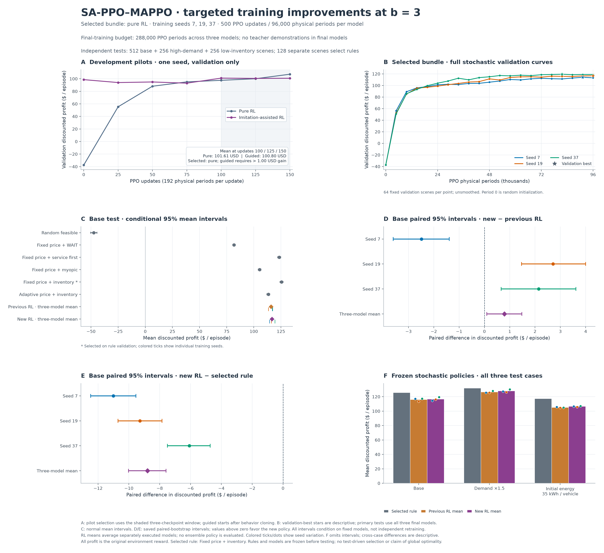

# Why SiLU + b=3 still lost to the inventory rule, and what the next training experiment changed

> Historical experiment. Its numbers belong to the scenarios and methods recorded here. Use [the current comparison](../COMPARISON.md) for approximate DP, both PPO versions, and the three main rules on shared tests. See [the archive index](README.md) for context.

Paths under `outputs/` refer to local experiment records and are not included in Git. Use the saved study files or reproduce the experiment to inspect them; [TRAINING.md](../TRAINING.md) explains the setup and current workflow.

**The targeted changes produced a small average gain, but did not produce a consistently better controller.** All three fresh runs reached 500 updates. On 512 new base-test scenarios, mean discounted profit rose from **115.93 for the previous policies to 116.72 for the new policies**. Seed 7 worsened, and every new seed remained below the retuned inventory rule's **125.51**.

This report records the completed **2026-10-18** follow-up to [the first SiLU + b=3 study](SILU_B3_STUDY.md). Both old and new policies use the **same b=3 customer model**. In that model, b is an optional baseline boost to the customer's score for charging rather than leaving the system; it is not battery capacity B. The business-profit objective and environment constraints remain the same. [MODEL.md](../MODEL.md), [OUTSIDE_OPTION.md](../reference/OUTSIDE_OPTION.md), and [NOTATION.md](../reference/NOTATION.md) explain the operating model and its symbols.

A **policy** is the learned rule for choosing actions. A **seed** is a number that makes a sequence of random values repeatable; changing the training seed can change the learned policy. **Discounted profit** gives slightly less weight to profit earned later in an episode.

Read the first two sections for the diagnosis, the next two for what was trained and how it was tested, and the results sections for what the evidence does and does not support. Reproduction commands and saved artifacts are at the end.

## What did the old policies fail to learn?

The earlier independent study measured mean profit of **116.42 for RL versus 125.26 for the inventory rule**. We used that study to guide this investigation, then reserved entirely new scenarios for this follow-up's final evaluation. Its 116.42 is therefore a historical result. To compare old and new policies fairly, we reran both on the new test scenarios.

To understand the behavior, we ran the old policies with their learned parameters held fixed and the inventory rule on **64 development scenarios**. MCV means mobile charging vehicle; FCS means fixed charging station. A vehicle's inventory is its stored battery energy. The inventory rule assigns an estimated value to preserving that energy for later service, while RL must discover useful sequences by trying actions in simulated episodes.

| Development measurement | Previous RL, three-policy mean | Inventory rule |
|---|---:|---:|
| Discounted business profit | 114.36 | 125.23 |
| Recharge energy purchased from the grid per episode | 0.24 kWh | 170.45 kWh |
| Mobile energy delivered per episode | 63.83 kWh | 157.72 kWh |
| Active mobile quote, model dollars/kWh | 0.834 | 0.600 |
| Final fleet stored energy | 31.40 kWh | 74.43 kWh |
| Periods in which both vehicles select the same SERVE target | 31.47% | 1.43% |
| SERVE actions that deliver zero energy | 33.65% | 0.00% |

The largest behavioral difference was replenishment. RL purchased almost no recharge energy, charged higher prices, and consumed its initial stock. It also often sent both vehicles to the same target or chose SERVE without delivering energy. The rule replenished and coordinated enough to support substantially more mobile service.

These decisions depend on one another. Lowering prices can attract more requests, but those requests help only if dispatch can serve them profitably. We therefore checked what happened when we exchanged one part of the controller without retraining:

| Frozen-module combination | Development profit | What the comparison suggests |
|---|---:|---|
| Previous learned pricing + learned dispatch | 114.36 | Reference behavior |
| Rule's fixed lower price + learned dispatch | 98.56 | More attractive prices alone overload the existing service/replenishment behavior |
| Learned pricing + inventory-rule dispatch | 112.21 | The rule's replenishment strategy is not automatically well matched to the learned price pattern |

A **module swap** keeps learned pricing and replaces dispatch, or keeps learned dispatch and replaces pricing. Neither swap closed the gap. These checks reveal how the fixed policies behave together. Retraining the changed combinations could produce different results, so the checks do not identify a single cause.

### Were the network and PPO implementation working as intended?

The review found two specific limitations in how the networks represented their inputs:

1. **Most features in earlier hidden layers were saturated.** Features are the intermediate values calculated inside a network. Tanh maps very large positive or negative inputs close to −1 or +1. There its derivative, which controls how much a value responds during training, is small; this is called **saturation**. Changing only the final dispatch activation to SiLU leaves earlier Tanh layers in place. Across **192 diagnostic training periods per seed**, **78.5–99.1%** of upstream dispatch features and **100%** of the pricing actor's final hidden features had absolute values above 0.99. This gave us a reason to keep the intermediate values within a more useful range.
2. **The shared dispatch actor could not distinguish otherwise identical vehicles.** The actor is the network that chooses actions. Its old encoder, which converts observations into network inputs, left out the already-public vehicle ID. Two vehicles at the same location with equal stored energy could therefore receive identical inputs, even though the simulator allocates whole requests in vehicle-index order. This made different vehicle roles difficult to learn when their physical states matched.

The review did not find a basic error in generalized advantage estimation (GAE), which estimates whether an action did better or worse than expected, or in stage discounting. The pricing-to-dispatch transition remains within a period; the physical-period discount is applied only when moving to the next period. Late in training, PPO Kullback–Leibler (KL) divergence, which measures how much the action probabilities change between updates, was small. The fraction of sampled probability ratios outside PPO's clipping range was also small, and no update was stopped early for changing the policy too much. In plain terms, measured policy changes were already small, so increasing the PPO clipping threshold was not supported by this evidence. Large critic gradient norms, which measure the combined size of the gradients before the optimizer uses them, did not alone show that critic learning had stalled. Late explained variance was about **0.9**; this metric describes how well the critic's predictions account for variation in its return targets.

The behavior findings (`outputs/b3_gap_diagnostics/findings.json`) and training audit (`outputs/b3_gap_diagnostics/training_audit.md`) retain the measurements, methods, and limits of those interpretations.

## What changes were tested, and why?

An **actor** chooses actions; a **critic** predicts future profit to help train the actor. PPO (Proximal Policy Optimization) learns from simulated episodes. Its **entropy** term encourages the actor to keep trying a range of actions. A **gradient** indicates how network parameters should change to reduce training error; **gradient clipping** limits its size before the optimizer applies the update. These definitions help explain the changes below. [Earlier PPO reference](../methods/LEGACY_PPO.md) walks through the full training cycle.

We tested the changes together. The results show how that combination performed; they do not measure the separate effect of each change.

| Change | Intended purpose |
|---|---|
| Layer normalization after each of the two hidden linear layers, before its activation | Keep intermediate network values in a useful range and address observed saturation in pricing, dispatch, and both critics |
| Public vehicle ID appended as a one-hot local dispatch feature | Let the shared actor learn different vehicle roles when physical states are identical |
| Training-only inventory-potential reward transformation | Make changes in stored energy more explicit in the training targets while preserving the business objective |
| GAE trace parameter $`\lambda_{\mathrm{GAE}}=1`$ for complete 12-period episodes | Use observed rewards through the end of the episode, without relying on intermediate critic predictions |
| Dispatch entropy coefficient scheduled from 0.020 to 0.003 over 500 updates; pricing stays 0.005 | Encourage more dispatch exploration early and reduce its strength later |
| Separate gradient clipping for each actor and critic, each at 0.5 | Limit each network's gradients separately, so a large gradient in one does not scale down another network's gradients |

**Layer normalization** rescales intermediate network values before the activation function processes them. A **one-hot vehicle-ID vector** has a 1 in the current vehicle's ID position and 0 in every other position. This gives the shared network an explicit way to tell vehicles apart.

The request encoders kept their network structure; the dispatch actor's final hidden activation stayed SiLU. Public ID did not supply future demand or the other vehicle's sampled action. Independent clipping limits each network's gradients separately before the optimizer uses them; this does not prove that clipping caused the old gap. The saved entropy schedule specifies how long its change takes. Resuming with a different number of additional updates therefore does not silently change that schedule.

### How can inventory shaping preserve the profit objective?

A *potential* is a reference value assigned to a state for training. **Potential-based shaping** adjusts the reward used for learning by the change in this reference value. Here it is \$0.30 per stored fleet kWh. Using one-based physical-period indexing, let $`s_t`$ be the pre-choice state in physical period $`t`$ and $`e_{m,t}`$ the stored energy of vehicle $`m`$. The training transformation is applied once per physical period:

```math
\begin{aligned}
\Phi(s_t)&=0.30\sum_{m\in\mathcal M}e_{m,t},\\
r'_t&=r_t+\gamma\Phi(s_{t+1})-\Phi(s_t).
\end{aligned}
```

The terminal state, after the episode ends, has its potential set to zero. When we add rewards over a complete discounted episode, the intermediate potential additions and subtractions cancel:

```math
\sum_{t=1}^{T}\gamma^{t-1}r'_t
=
\sum_{t=1}^{T}\gamma^{t-1}r_t-\Phi(s_1).
```

For a fixed starting scenario, the subtracted initial potential does not depend on the policy. This transformation changes training targets without creating extra true profit for recharging or leaving stock at the end. The environment's revenue, costs, constraints, raw rollout rewards, validation returns, and benchmark profits are unchanged. Tests verify cancellation of the potential terms and correct terminal handling.

With $`\lambda_{\mathrm{GAE}}=1`$, complete-episode shaped returns are the original returns minus the current state's potential. This can change how the critic learns and how early training progresses. It does not guarantee that trying actions will uncover a profitable recharge-then-service sequence. It should not be interpreted as an additional economic charging subsidy.

The new options are off by default, preserving previous behavior. Old checkpoints, which are saved copies of trained models, keep their existing network structure and customer model. Resuming a run rejects changes to saved network options, inventory potential, or training-seed base. Here $`\lambda_{\mathrm{GAE}}`$ is the GAE trace parameter; the model's $`\lambda_{i,t}`$ continues to mean Poisson arrival intensity only.

## How was the final training method chosen?

Before the long runs, two short seed-7 pilot runs received **150 updates each**, with the changed architecture and settings. One started from random network weights. The other first learned to copy the previously selected inventory rule using **256 separate demonstration episodes and 20 supervised epochs**, then ran PPO. The demonstration actions were based only on observations available at that decision stage. They were not mixed into PPO's on-policy rollout, the batch of episodes generated by its current policy. This imitation warm-up did not change the critics, PPO optimizer state, or PPO training counters. A supervised epoch is a training pass over the demonstration data.

The selection rule was fixed in advance. Stochastic validation samples actions from the policy's learned probabilities. We averaged stochastic validation profit at updates **100, 125, and 150**, and chose guided initialization only if it exceeded ordinary initialization by more than **1.00**.

| Pilot | Update 100 | Update 125 | Update 150 | Selection score |
|---|---:|---:|---:|---:|
| PPO without imitation | 97.55 | 100.04 | 107.25 | **101.61** |
| Imitation warm-up, then PPO | 101.03 | 100.55 | 100.82 | 100.80 |

The selected method therefore used **no imitation training**. The rejected guided pilot remains part of the reported development cost. All three full runs started from scratch; neither pilot weights nor an old seed-7 run was reused.

| Full-run setting | Value |
|---|---:|
| Training seeds | 7, 19, 37 |
| Updates / complete episodes per update | 500 / 16 |
| PPO epochs / minibatch size | 6 / 192 physical periods |
| Hidden width | 64 |
| Actor / critic learning rate | 0.0003 / 0.001 |
| Value clipping | Disabled |
| Ratio clip / target KL | 0.2 / 0.03 |
| Discount / outer discounted policy weighting | 0.99 / enabled |
| Training exposure per model | 8,000 episodes / 96,000 physical periods |
| Training validation | 64 scenarios, every 25 updates |

The primary policies were the final stochastic models: they sample actions from their learned probabilities. Final deterministic models choose the highest-probability discrete actions and the mean energy fraction. These, and stochastic models saved at their best validation score, were secondary comparisons. Each training seed used a **disjoint block of even environment seeds**: the runs did not share training scenarios, unlike the previous study's substantially overlapping schedules. This tests more variation in training data, but it is also another change between the studies. Three runs still provide limited evidence about other possible training runs. We cannot fully separate the effect of the new training settings from the effect of the changed training data.

## How were the final comparisons kept independent?

We used development scenarios to understand behavior and choose between the pilots. A separate rule-validation set selected benchmark settings. The final base and stress scenarios were kept for reporting after model weights, rule settings, and comparison choices were fixed. This fixed plan is the **frozen protocol**.

| Purpose | Scenarios | Environment seeds |
|---|---:|---|
| Development behavior diagnostic | 64 | `4100001 + 2*i` |
| Pilot and training validation | 64 | `4300001 + 2*i` |
| Rule validation | 128 | `4500001 + 2*i` |
| Final base test | 512 | `4700001 + 2*i` |
| High-demand stress test | 256 | `4900001 + 2*i` |
| Low-inventory stress test | 256 | `5100001 + 2*i` |

The existing **61 benchmark candidates** were retuned on new rule validation. The strongest remained inventory joint dispatch, which chooses vehicle actions together, at price **0.60** and shadow value **0.30**, with validation profit **126.29**. A **shadow value** is the estimated value assigned to stored energy when scoring an action. The rule uses the known physical model to compare combinations of vehicle actions, while MAPPO executes separate vehicle policies. Neither knows future random outcomes. The rule's model knowledge and coordination are real advantages. It supplies a strong feasible comparison using a finite set of candidate energy amounts; it does not identify the best possible policy for the whole episode, and its structure differs from the learned controller.

Within every final case, all six selected rules and both sets of three trained policies used the same scenarios. High demand multiplied arrival intensities by **1.5**; low inventory started each vehicle with **35 kWh**. Each case used its own scenario seeds. Policy comparisons within a case therefore matched the same scenarios. Differences between cases describe the separate samples; they do not isolate the effect of changing only demand or starting energy.

Two success criteria were fixed before testing: consistent improvement over the previous policies, and consistent advantage over the selected rule. Each required a positive point difference for **every training seed** and a positive lower endpoint of the aggregate paired 95% bootstrap interval.

A **paired bootstrap interval** starts with the policy difference on each shared scenario. It repeatedly draws new samples from those scenarios and recalculates the mean difference. We used **5,000 bootstrap draws**. The resulting interval describes uncertainty from the sampled scenarios while keeping these trained models fixed. This is what **conditional on the models** means; it does not cover all possible retraining outcomes. The primary mean averages the results of three separately executed policies; it does not combine their actions. Its 512 scenarios are not 1,536 independent training experiments. We also report each policy's interval, variation between training seeds, and risk.

No test result led to extra training, changed hyperparameters, benchmark retuning, or replacement of the primary seed, execution mode, or checkpoint. The study protocol (`outputs/b3_improved_study/protocol.json`), pilot selection (`outputs/b3_improved_study/pilot_selection.json`), and rule selection (`outputs/b3_improved_study/rule_selection/selection.json`) preserve those choices.

## Did the new policies improve consistently?

All following values are discounted **original business profit**, not shaped training reward. Previous and new policies ran the **same fresh base-test scenarios**. The old study's 116.42 is not the control mean on this split.

| Training seed | Previous final SiLU + b=3 | New final policy | Change | Paired 95% interval for change |
|---|---:|---:|---:|---|
| 7 | 116.99 | 114.50 | −2.49 | [−3.60, −1.39] |
| 19 | 113.52 | 116.23 | +2.71 | [1.47, 4.00] |
| 37 | 117.29 | 119.43 | +2.14 | [0.66, 3.62] |
| Three-policy mean | **115.93** | **116.72** | **+0.79** | **[0.10, 1.48]** |

The average gain was positive for these fixed models on the sampled scenarios, but seed 7 performed worse. The new policies also remained **8.79 below the rule**, a **7.00% shortfall**, with interval **[−10.03, −7.59]**. Every seed had a negative interval against the rule. Compared with the previous gap of **9.58**, the bundle closed only **8.24%** of the gap.

Both base-test criteria fixed before testing therefore failed. The positive aggregate interval does not establish reliable gains across other training runs. The between-seed standard deviation, which measures how much the models' mean profits differ from one another, increased from **2.10 to 2.50**.

### How did the other methods compare?

| Base-test policy | Mean discounted profit |
|---|---:|
| Random feasible actions | −47.40 |
| Fixed price + WAIT | 81.77 |
| Fixed price + service first | 123.40 |
| Fixed price + myopic dispatch | 105.33 |
| Fixed price + inventory joint dispatch | **125.51** |
| Adaptive price + inventory dispatch | 113.45 |
| Previous final stochastic RL | 115.93 |
| New final stochastic RL: primary | 116.72 |
| New final deterministic RL: secondary | 114.94 |
| New validation-selected stochastic RL: secondary | 116.48 |

The simpler service-first rule also exceeded new RL. Changing execution mode or using validation-selected checkpoints did not close the gap. These were secondary checks and did not replace the primary final stochastic policies.

### Did the result hold in the stress cases?

| Independent case | Scenarios | Previous RL | New RL | Inventory rule | New minus previous, paired 95% interval | New minus rule, paired 95% interval |
|---|---:|---:|---:|---:|---|---|
| Base | 512 | 115.93 | 116.72 | 125.51 | +0.79 [0.10, 1.48] | −8.79 [−10.03, −7.59] |
| Arrival intensity ×1.5 | 256 | 126.43 | 127.89 | 131.90 | +1.46 [0.38, 2.58] | −4.01 [−6.31, −1.82] |
| Initial energy 35 kWh per vehicle | 256 | 105.09 | 106.51 | 117.17 | +1.42 [0.67, 2.24] | −10.66 [−12.56, −8.67] |

All three seeds had higher measured mean profit than their old controls in each stress case, but the new policies' average stayed below the rule in both cases. Across all cases there were **1,024 distinct final test scenarios and 16,896 policy-episode executions**. The latter counts repeated evaluations of different policies on shared scenarios; it is not a count of independent statistical samples.

## What behavior still explains the remaining gap?

The independent base test still showed a policy that relied on initial energy and scarcely replenished it:

| Base-test measurement per episode | Previous RL mean | New RL mean | Inventory rule |
|---|---:|---:|---:|
| Recharge grid energy | 0.23 kWh | **0.18 kWh** | 173.24 kWh |
| Mobile energy delivered | 63.86 kWh | 62.50 kWh | 156.41 kWh |
| Final fleet stored energy | 30.93 kWh | 31.91 kWh | 76.89 kWh |
| Export grid energy | 0.34 kWh | 0.80 kWh | 16.80 kWh |
| Served share of potential requests | 42.07% | 42.06% | 45.31% |
| Outside-option share | 52.75% | 52.77% | 48.80% |
| Mean profit in worst 10% of episodes | 87.22 | 87.64 | 97.71 |

There were **24 vehicle decisions per episode**, but new RL chose RECHARGE only **0.0215 times per episode**. Repositioning fell from **5.49 to 0.69 decisions**, mostly becoming waiting. It did not discover the intended sequence of buying energy and later earning enough from service to justify that purchase.

We also repeated the original 64-scenario **development diagnostic** after training, to compare action-level behavior. Active prices stayed at **0.835**, versus **0.834** before and **0.600** for the rule. Duplicate SERVE targets fell only from **31.47% to 30.77%** of periods. Zero-delivery SERVE actions fell from **33.65% to 32.87%**, versus **0%** for the rule. These are reused development scenarios, not another independent test set. Adding vehicle identity allowed the network to distinguish vehicle roles, but the learned assignments still coordinated the vehicles poorly.

Breaking the independent discounted profit difference into revenues and costs shows where the remaining rule advantage comes from:

| Component of new-RL-minus-rule profit | Amount |
|---|---:|
| Mobile-service revenue | −47.56 |
| Export revenue | −1.41 |
| Higher FCS service revenue | +14.70 |
| Lower procurement cost | +21.42 |
| Lower travel cost | +2.50 |
| Lower unmet-demand penalties | +1.56 |
| Net | **−8.79** |

The rule's much larger mobile revenue more than paid for its extra procurement and travel. The small **+0.79** change over previous RL was mostly **+0.52 mobile-service revenue and +0.21 FCS-service revenue**; recharge and mobile volume did not improve. More energy exchanged, or lower prices in isolation, would not automatically increase net profit.

The behavior suggests a remaining difficulty with exploration and coordination: the policies rarely learned useful recharge-then-service sequences or vehicle assignments that complement one another. This is an interpretation, not proof of which individual component caused the problem. The review did not find an error in PPO's action-probability calculation, GAE, or the checks that actions obey physical limits. Normalization, vehicle identity, and shaping addressed real limitations, but did not solve the operating problem.

A next experiment should explicitly test learning complete recharge-and-service sequences and coordinated assignments. The short imitation warm-up tested here was insufficient; repeating it unchanged or only extending training is not an evidence-backed fix. The inventory rule remains the stronger evaluated controller, and the new training options remain experimental.

## Was the result stable and reproducible?

All three full runs had finite metrics, zero invalid evaluation actions, and exact checkpoint-reload evaluation. Across the six validation checkpoints at updates **375 through 500**, the profit ranges had widths **2.82, 2.34, and 0.92** for seeds 7, 19, and 37. The three-policy mean ranged from **115.10 to 116.49**. This was a late **plateau**: measured profit changed little but remained below the rule. It does not prove convergence toward a limiting policy or establish that the policy is good. Seed 19 was still improving at the final checkpoint. Training was not extended after testing.

The complete suite passed **142 tests**: the prior 112 plus 30 for identity, normalization, potential cancellation, entropy schedules, separate clipping, checkpoint compatibility, imitation isolation, and experiment guards. All **7,808 rule-validation** and **16,896 independent-test** policy episodes had zero invalid actions. Both development diagnostic passes also had zero invalid actions. See [VALIDATION.md](../reference/VALIDATION.md) for the current documentation of these checks.

Training cost was **288,000 PPO physical periods** for the three fresh full runs, plus **57,600 PPO periods** for the two pilots and **3,072 teacher-demonstration periods** for the rejected guided pilot. Each final model had the same **96,000-period** PPO budget as its old control, but the extra development budget is part of this study's cost. `outputs/b3_improved_study/analysis.json` records evaluation and diagnostic costs separately.

Protocols store checkpoint and source hashes, file fingerprints used to check that saved model weights and code have not changed. A read-only executed-source snapshot (`outputs/b3_improved_study/provenance/executed_training_source/manifest.json`) preserves all **16 training source files** exactly as executed. After training, the experiment runner gained stricter checks against scenario/configuration changes and incomplete pilot summaries; learning code did not change. The before/after hashes and completed-run checks (`outputs/b3_improved_study/provenance/reproduction_guard_hardening.json`) explain that difference. The original frozen protocol was retained.

Final checkpoints are saved for seed 7 (`outputs/b3_improved_study/training/seed_7/checkpoint.pt`), seed 19 (`outputs/b3_improved_study/training/seed_19/checkpoint.pt`), and seed 37 (`outputs/b3_improved_study/training/seed_37/checkpoint.pt`). The benchmark summary (`outputs/b3_improved_study/benchmarks/summary.json`), analysis (`outputs/b3_improved_study/analysis.json`), and test log (`outputs/b3_improved_study/reviews/unit_tests.log`) contain the supporting records.



## Reproduction

From the project root, activate the existing training virtual environment and choose a new study directory. The earlier final models are frozen comparison controls, not training inputs.

```bash
source .venv/bin/activate
python experiments/run_b3_improved_training.py --phase init \
  --study-dir outputs/b3_improved_repeat \
  --previous-root outputs/silu_b3_study/training
python experiments/run_b3_improved_benchmarks.py --phase select \
  --study-dir outputs/b3_improved_repeat
for bundle in pure guided; do
  python experiments/run_b3_improved_training.py --phase pilot --bundle "$bundle" \
    --study-dir outputs/b3_improved_repeat
done
python experiments/run_b3_improved_training.py --phase choose \
  --study-dir outputs/b3_improved_repeat
for seed in 7 19 37; do
  python experiments/run_b3_improved_training.py --phase train --seed "$seed" \
    --study-dir outputs/b3_improved_repeat
done
python experiments/run_b3_improved_benchmarks.py --phase evaluate \
  --study-dir outputs/b3_improved_repeat
python experiments/summarize_b3_improved_study.py --study-dir outputs/b3_improved_repeat
python experiments/plot_b3_improved_study.py --study-dir outputs/b3_improved_repeat
```

Plotting alone requires optional Matplotlib. Training and evaluation use the existing training dependencies. Training, benchmark, and analysis commands refuse to overwrite evidence; plotting can regenerate the PNG. Reusing the published test scenarios checks the recorded results. Any further choice of models or settings needs a fresh final test set that has not influenced those choices.
