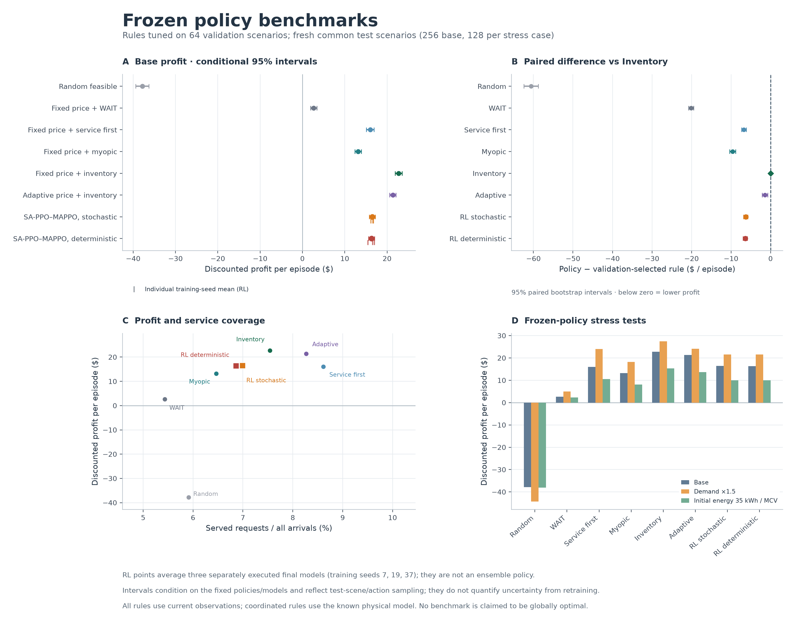

# 02. How good was the policy? The first independent benchmark study

**Date:** 2026-10-17 · **Historical study.** Its numbers use this study's own test days and settings, so compare controllers within this report only. Current results are in [RESULTS.md](../RESULTS.md); all studies are listed in the [index](README.md).

In this report, "RL" means earlier PPO. Scripts are in `experiments/archive/`. Paths under `outputs/` are local results that are not in Git.

**The learned policy was profitable, but a coordinated inventory rule earned more.** A policy is a decision rule; reinforcement learning (RL) learns one by trying actions in simulated operating episodes. A **benchmark**, also called a baseline, is another decision rule used as a point of comparison. On 256 new test scenarios, the three final stochastic policies averaged **16.49** discounted model dollars per episode. The validation-selected inventory rule earned **22.75**. RL was **6.26 lower, or about 27.5%**, with a paired 95% bootstrap interval of **[−6.81, −5.73]** for RL minus the rule. The testing section below explains what that interval tells us.

This report records the completed **2026-10-17 historical comparison under b=0**, the original customer-choice model. The existing network weights were **frozen**, meaning they were kept fixed throughout evaluation. There was no further training or change to the profit formula. It followed [the longer-training investigation](01_ppo_training_curve.md): the training curve showed whether performance had settled down, while these benchmarks showed how good the resulting decisions were. Later b=3 results are in [study 04](04_silu_b3.md) and [study 05](05_ppo_improvements.md).

Start with [MODEL.md](../MODEL.md) for the operating process and [NOTATION.md](../reference/NOTATION.md) for symbols. Below, MCV means mobile charging vehicle and FCS means fixed charging station. One episode contains 12 physical periods. Profit is discounted by 0.99 per period: later profit receives slightly less weight than earlier profit. It includes both mobile and FCS business operations.

## What should a useful policy do well?

Mean profit is the main objective, but an average does not describe everything a policy does. This study used five questions:

| Question | What we measure | How to interpret it |
|---|---|---|
| Does it earn more than a credible alternative? | Mean discounted net profit and a paired difference from a rule selected before testing | Beating random actions establishes a learning signal; beating a strong rule is a more useful practical target |
| Does it serve customers? | Share of potential requests served, fulfillment of selected requests, mobile kWh, and outside-option share | A policy may serve almost everyone who chooses it while attracting very few customers |
| Does it perform poorly in difficult episodes? | Probability of loss, 10th-percentile profit, and mean profit in approximately the worst 10% of episodes | A high mean can coexist with weak outcomes in adverse scenarios |
| Does it generalize? | Frozen-policy performance under changed demand or initial energy | A stress test should not quietly retune the method for the changed setting |
| Is it feasible and practical? | Valid actions, energy conservation, information used, decision latency, and model knowledge | Faster decisions or richer model knowledge may affect whether a comparison is operationally useful |

“Potential requests served” divides the number served by all arriving requests, including customers who later choose the outside option and leave. “Selected requests fulfilled” divides the number served by only those requests that chose this operator. For fulfillment, the report adds up served and selected requests across episodes for each model, then divides the totals. For service coverage, it calculates the share in each episode and averages those shares. These measures answer different questions and should not be interchanged.

## What are the competing rules?

All methods face the same environment, action constraints, initial conditions, and profit formula. Pricing sees the pre-choice state $`s_t`$. Dispatch sees the post-choice state, $`\tilde s_t`$, after the current customers choose. No method sees future realized demand or future random draws.

The adaptive pricing rule uses the multinomial logit (MNL) customer-choice model described in [MODEL.md](../MODEL.md). MNL calculates the probability that a customer chooses each charging option or leaves, based on the options’ preference scores. A *myopic* rule considers only profit in the current period. An *inventory-value* rule also assigns a provisional value to battery energy left for later periods. For example, a shadow value of \$0.10 per stored kWh credits a 10-kWh increase in stored energy with \$1 in the rule's decision score. This helps it consider recharging even when charging costs money immediately. That provisional score is used to choose an action; it is never added to the business profit reported in the tables.

| Benchmark | How it sets mobile prices | How it dispatches vehicles | Validation candidates |
|---|---|---|---:|
| Random | Samples each available node's price uniformly | Samples a valid mode/target and uniform exchange-energy amount | 1 |
| Waiting reference | Uses a tuned uniform fixed price | MCVs wait; fleet operating costs and FCS business still apply | 7 |
| Service first | Uses a tuned uniform fixed price | Coordinates requests, prioritizes service with positive contribution, and recharges at low energy | 21 |
| One-period profit rule | Uses a tuned uniform fixed price | Searches feasible joint actions for the highest actual current-period profit | 7 |
| Inventory-value rule | Uses a tuned uniform fixed price | Searches joint actions using current profit plus the shadow value of the inventory change | 21 |
| Adaptive pricing rule | Uses current MNL customer-choice probabilities and capacity to approximate node-level expected profit | Uses inventory-value joint dispatch with a tuned shadow value | 4 |

The fixed-price search covers all **seven** allowed prices. Service-first recharge thresholds are usable-energy fractions **0.2/0.4/0.6**. Nonzero inventory shadow values are **0.1/0.2/0.3 dollars per stored kWh**; adaptive pricing also includes zero. The full search contains **61 candidates**.

For **joint dispatch**, the rule considers both vehicles together. It lists the allowed combinations of vehicle actions and scores each combination. Charging and discharging request either **50% or 100%** of the physically feasible maximum. WAIT and REPOSITION cover actions with no energy exchange. Shared station capacity is allocated proportionally. In the last period, the rule adds no provisional value for stored energy. Any payment for final inventory already included in the environment's true profit still applies.

The rule uses a **forward model**: a calculation that predicts what each candidate action would do. This calculation was checked against the simulator for request allocation, prevention of serving the same request twice, shared station capacity, efficiency losses, costs, and final inventory value. Request allocation uses the same whole-request first-fit order as the simulator: a request is served only if its full energy need fits. The rule uses current public observations and known physics. It is **centralized** because it chooses both vehicles’ actions together, and **model-based** because it uses those physical calculations directly. Its energy choices come from a limited list. It does not search every possible action sequence through the whole episode, so its result is not a proven best achievable profit. These coordination and model advantages matter when comparing it with RL, which learns from experience and also requires training.

## How were tuning and testing kept separate?

**Tuning** means trying settings and choosing among them. This study used validation scenarios for tuning the rule parameters. It then kept the selected settings fixed and measured performance on unseen test scenarios. Keeping those jobs separate prevents the test results from influencing which settings are chosen. The selected settings were:

| Rule | Validation-selected setting |
|---|---|
| Waiting | Price 1.00 |
| Service first | Price 0.50; recharge threshold 0.20 |
| One-period profit | Price 0.40 |
| Inventory value, the strongest family on validation | Price **0.50**; shadow value **0.10** |
| Adaptive pricing | Shadow value 0.10 |

All candidate results are in `outputs/policy_benchmarks/selection.json`. The strongest rule family was also selected on validation, rather than chosen after seeing test outcomes.

| Split | Distinct scenarios per case | Environment seeds | Purpose |
|---|---:|---|---|
| Rule validation | 64 | `700001 + 2*i` | Select from 61 rule candidates: 3,904 executions |
| Default test | 256 | `900001 + 2*i` | Compare frozen policies on a new split |
| Each stress case | 128 | `1100001 + 2*i` | Check frozen policies under a changed scenario |

The action seed is **54123**. A **seed** is a number that lets us reproduce a sequence of random draws. Within each case, policies use the same environment seeds, so they face matching random draws for arrivals, requested energy, station price changes, and customer choices. Sampling actions from the policy uses a separate random number generator (RNG). The same customer-choice draw can still produce different choices when policies offer different prices. Pairing therefore matches the underlying scenarios; it does not force all policies to attract identical demand.

The main RL result averages **three separately executed final stochastic policies**. A stochastic policy samples actions from its learned probabilities. We also report deterministic execution, which takes the most likely discrete actions and the mean energy fraction, and historical validation-selected checkpoints, which are saved models chosen using validation performance. These are secondary results. Test return never selects a seed, execution mode, or checkpoint. An average row over 256 scenarios requires **3 × 256 = 768 policy-episode executions**. Each policy contributes equally to that average; the vehicles do not combine actions from multiple models.

A **paired comparison** subtracts one method's return from the other method's return within each shared scenario. To form the paired bootstrap confidence interval (CI), we repeatedly resample the scenario differences, allowing a scenario to be selected more than once, **5,000 times**. An interval entirely below zero means the observed disadvantage is unlikely to be explained only by which test scenarios were sampled, for these fixed trained models. This interval does not cover all possible results of training the algorithm again. Different training seeds can produce different learned models, so we show the three training-seed results separately. Testing on 256 scenarios is not the same as training 256 independent models. See [Agarwal et al.](https://arxiv.org/abs/2108.13264) for background on RL evaluation uncertainty.

Learned policies retain their training-time feature normalization constants during stress tests. No recalibration or retraining is performed. The frozen protocol (`outputs/policy_benchmarks/protocol.json`) records configurations, source hashes, and checkpoint hashes; checkpoint hashes were checked again after testing.

## How did the methods compare under the default scenario?

The units are discounted model dollars per 12-period episode, with gamma=0.99. The final column averages each method's profit in its worst approximately 10% of episodes. This is a **lower-tail** measure: it describes difficult outcomes that a mean can hide. In RL average rows, we first calculate this measure separately for each policy, then average the measures. We do not first average the policies' returns in each scenario, because doing so could hide one policy's poor outcomes.

| Method | Mean discounted profit | Potential requests served | Selected requests fulfilled | Mobile kWh per episode | Mean profit in worst approximately 10% |
|---|---:|---:|---:|---:|---:|
| Random feasible actions | −37.82 | 5.91% | 53.88% | 13.13 | −60.50 |
| Fixed price + MCV waiting | 2.67 | 5.43% | 93.85% | 0.00 | −7.04 |
| Fixed price + service first / recharge at low energy | 16.01 | 8.61% | 99.07% | 44.49 | 3.68 |
| Fixed price + one-period profit dispatch | 13.16 | 6.46% | 96.89% | 15.07 | 3.31 |
| Fixed price + inventory-aware joint dispatch | **22.75** | 7.54% | 96.01% | 29.69 | **12.15** |
| Adaptive myopic pricing + inventory-aware dispatch | 21.35 | 8.27% | 93.90% | 44.03 | 11.23 |
| Final SA-PPO–MAPPO, stochastic | 16.49 | 6.99% | 96.04% | 23.26 | 5.68 |
| Final SA-PPO–MAPPO, deterministic | 16.34 | 6.86% | 95.64% | 21.83 | 5.58 |
| Historical validation-selected SA-PPO–MAPPO, stochastic | 16.32 | 6.91% | 96.24% | 21.97 | 4.64 |
| Historical validation-selected SA-PPO–MAPPO, deterministic | 16.75 | 6.65% | 97.22% | 17.52 | 5.98 |

RL clearly outperformed random actions. Its mean profit was close to service first, but service first served more potential requests and delivered more mobile energy. The inventory rule earned substantially more and had better lower-tail profit. The service-first settings were selected fairly on validation; they were not weakened to make RL look better.

The primary result was not driven by just one poor training seed:

| Training seed | Final stochastic profit | RL minus selected inventory rule | Paired 95% interval |
|---|---:|---:|---|
| 7 | 16.126 | −6.623 | [−7.282, −5.982] |
| 19 | 16.599 | −6.150 | [−6.842, −5.498] |
| 37 | 16.736 | −6.013 | [−6.717, −5.349] |

All three differences and their intervals were negative. Neither deterministic execution nor the validation-selected models reversed that conclusion.



## Where did the rule's extra profit come from?

The table breaks **rule profit minus mean final stochastic RL profit** into discounted revenue and cost differences. Extra revenue is positive, and a cost saving is positive. A negative entry means the rule spent more or earned less in that category. The entries add to the total profit gap. They show where the measured difference appears in the accounts; they do not prove that changing any one behavior alone would produce that amount of improvement.

| Component | Contribution to the rule's advantage |
|---|---:|
| Higher mobile charging revenue | +4.224 |
| Change in FCS revenue | +0.165 |
| Higher discharge revenue | +1.244 |
| Electricity procurement cost saving | −0.153 |
| Travel cost saving | +0.717 |
| Operating cost saving | −0.000 |
| Unserved-demand penalty saving | +0.066 |
| Change in terminal value | +0.000 |

Higher mobile service revenue, discharge revenue, and lower travel cost explained most of the observed advantage. Final fleet inventory was about **11.49 kWh for the rule and 12.73 kWh for RL**, both near the minimum reserve. The gap therefore could not mainly be explained by the rule selling substantially more of its initial stock. Both methods fulfilled about **96%** of selected demand; mobile energy delivered and the timing of discharge and movement remained useful diagnostic targets.

Several economic assumptions limit interpretation. The episode starts with **110 kWh** of inventory without charging its acquisition cost inside the episode. Default terminal value is zero, the outside-option share is high, and profit includes FCS operations. These assumptions are the same for all policies, but they shape what is profitable. The table is a synthetic model comparison, not an operating-profit forecast.

We also avoided inferring effective selling prices from the old mean-quoted-price field, because it includes placeholder entries for unavailable nodes. Likewise, counting a SERVE or RECHARGE action does not show how many kWh it actually delivered.

## Did the result survive changed conditions?

The high-demand case multiplies only the average arrival counts in the Poisson demand model by **1.5**. The low-inventory case changes only each vehicle's initial energy from **55 to 35 kWh**. All prices, rule settings, and network weights remain fixed. Policies share matching scenarios within each case. The default and stress cases use different scenario seeds, however, so a difference between cases includes different random scenarios as well as the changed setting. It does not isolate the effect of that setting.

| Scenario | Selected inventory rule | Mean stochastic RL | RL minus rule and paired 95% interval |
|---|---:|---:|---|
| Default | 22.75 | 16.49 | −6.26 [−6.81, −5.73] |
| Arrival intensity ×1.5 | 27.43 | 21.52 | −5.90 [−7.08, −4.73] |
| Initial energy 35 kWh per vehicle | 15.35 | 10.03 | −5.32 [−6.24, −4.36] |

RL stayed below the rule in both stress cases. With low initial inventory, its mean loss probability was about **5.73%**, versus **0.78%** for the rule. The original benchmark gap therefore persisted beyond the default case.

Calculating decisions on this machine's CPU took about **0.659 ms per physical period for RL pricing plus dispatch**, versus **0.190 ms for the inventory rule**. These times exclude training, loading, and running the simulator after the action. They apply to this machine. Checking all allowed joint action combinations is cheap for two vehicles and four nodes, but the number of combinations grows rapidly with fleet size; the implementation rejects searches above **200,000 combinations**. These timings do not tell us directly how fast either method would run in a larger system.

## What did this study establish, and what is still missing?

For this b=0 synthetic environment, the evaluated RL policies were not the strongest available profit-maximizing controller. The inventory rule provided a concrete target for improvement. This study did not establish whether SA-PPO–MAPPO is better than other RL algorithms.

A research comparison of the framework itself would require the following additional experiments:

- **Other learning algorithms:** train alternatives with multiple seeds, such as independent PPO (IPPO), where each vehicle learns separately, and centralized PPO, where a policy chooses joint actions. Give the methods comparable observations, allowed actions, training data, and tuning budgets. This project combines discrete operation choices with continuous energy fractions, so alternatives must support that combination. Comparing standard DQN or SAC implementations that allow different actions would be difficult to interpret.
- **Retrained component comparisons, often called ablations:** fixed pricing + MAPPO, SA-PPO + fixed dispatch, and a version without stage-aware credit assignment, which accounts for the different timing of pricing and dispatch when learning. Change one component and train the resulting system again. Swapping a component only at evaluation helps diagnose behavior, but does not show what the altered system could learn.
- **Small optimization references:** methods that search future action sequences, such as dynamic programming or repeatedly optimizing over a limited set of future scenarios. State clearly how they simplify continuous actions or uncertain futures. A method allowed to see the future random outcomes must be labeled as having stronger information.
- **Broader frozen scenarios:** different fleet sizes, node counts, demand patterns, station capacities, price shocks, initial-inventory costs, and terminal values.

These were proposed follow-ups, not completed results in this report. [Yu et al.](https://arxiv.org/abs/2103.01955) provides background on MAPPO in other cooperative tasks; success there is not evidence of superiority in this charging environment.

## Saved evidence and reproduction

The implementation is in `src/charging_env/benchmarks/`. Rules and evaluation do not need PyTorch; the frozen-policy adapter does. This historical study left the environment, trainer, and existing weights unchanged.

```bash
source .venv/bin/activate
python -m unittest discover -s tests -v
# Keep saved evidence; reproduce into a new directory.
python experiments/archive/run_policy_benchmarks.py --output-dir outputs/policy_benchmarks_repeat
# Plotting alone additionally needs matplotlib.
python -m pip install 'matplotlib>=3.9,<4'
python experiments/archive/plot_policy_benchmarks.py --output-dir outputs/policy_benchmarks_repeat
```

The complete experiment used **61 × 64 rule-validation executions**, **18 × 256 default-test executions**, and **2 × 12 × 128 stress-test executions**: **11,584 policy episodes in total**. These count each policy's run through an episode; several policies can run on the same scenario. Every execution had zero invalid actions. The suite at the time passed **81 tests**, including 17 new checks for the separate physical prediction model, joint action search, separation of random number streams, and the shared interface used to run policies. See [VALIDATION.md](../reference/VALIDATION.md) for the current suite.

Saved artifacts include the complete JSON (`outputs/policy_benchmarks/summary.json`), default-case CSV (`outputs/policy_benchmarks/base/summary.csv`), profit decomposition (`outputs/policy_benchmarks/gap_diagnostics.json`), PNG chart (`outputs/policy_benchmarks/comparison.png`), and vector PDF (`outputs/policy_benchmarks/comparison.pdf`).
